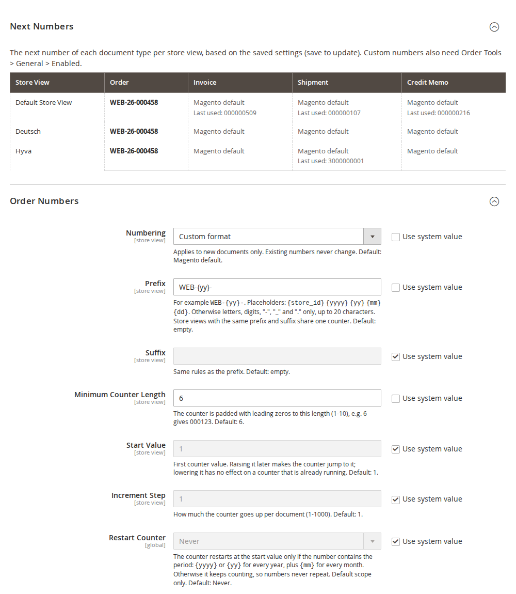
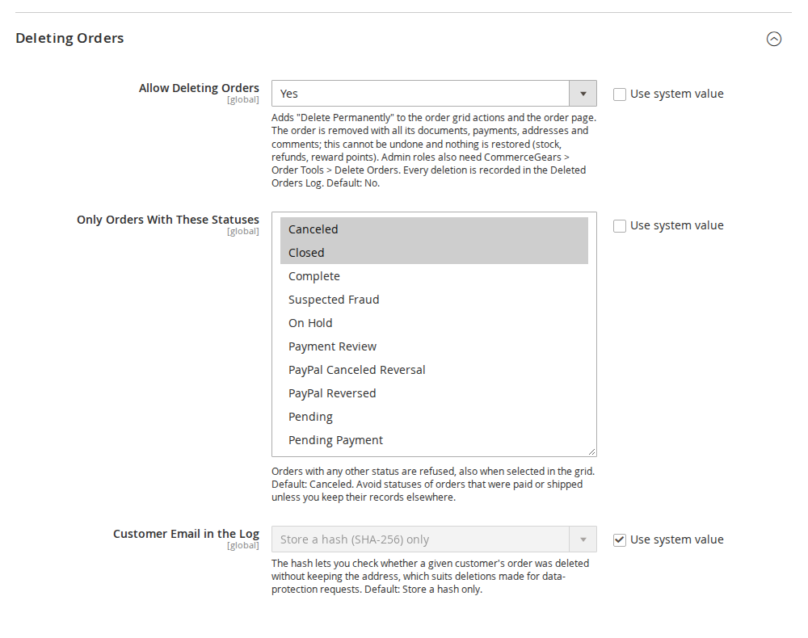
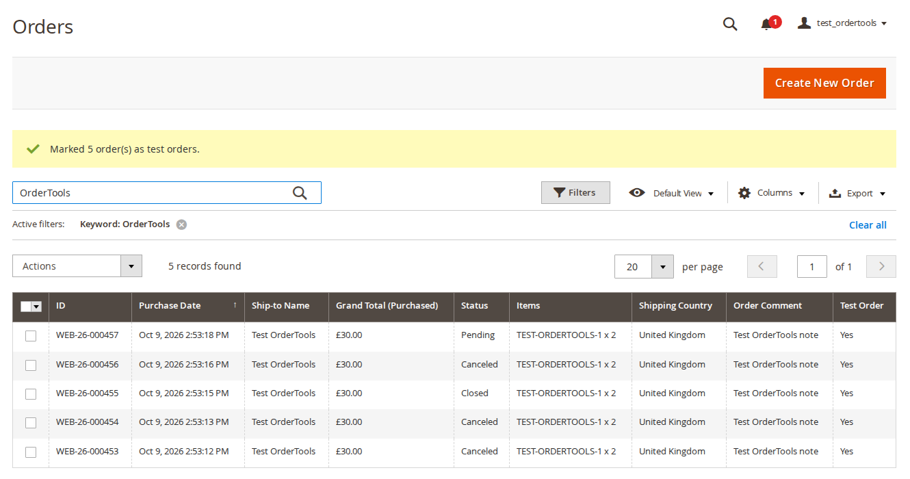
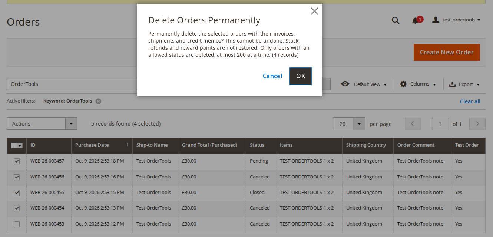
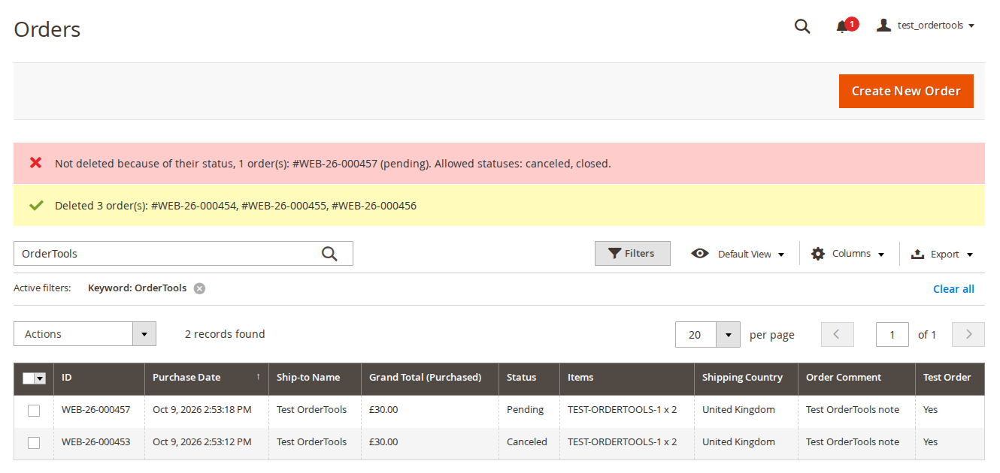
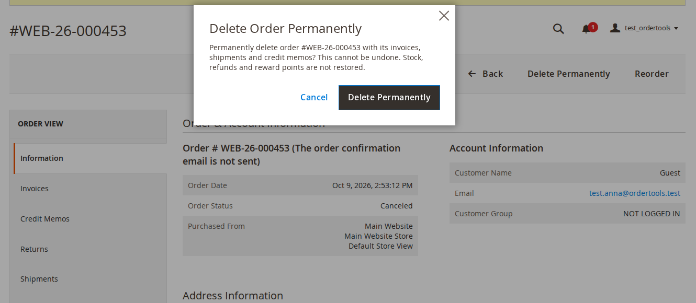
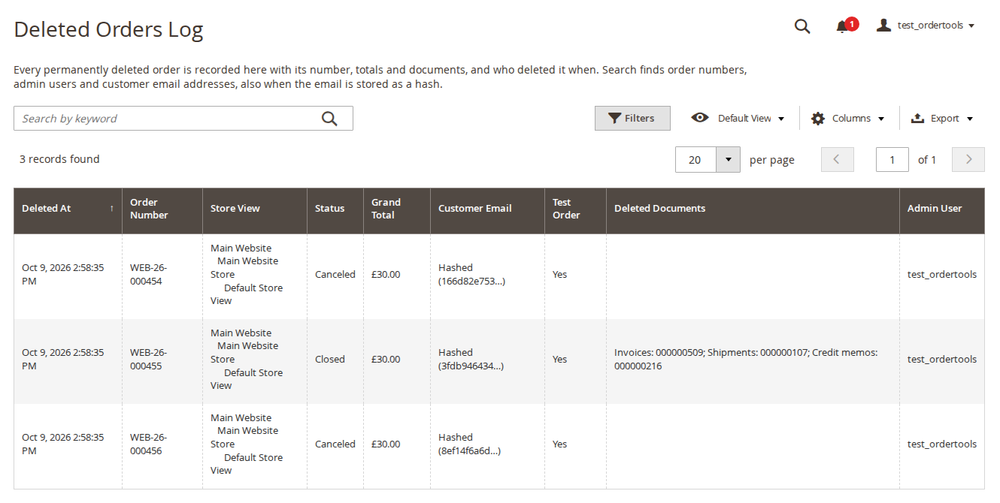

# Order Tools for Magento 2: User Guide

Small, frequently requested order utilities in one module: your own order, invoice, shipment and credit memo
numbers, extra columns in the order grid, a test order flag and guarded order deletion with an audit log.
Everything that changes behaviour is off by default. This guide covers installation, configuration and
day-to-day use.

- Admin demo: https://demo.commercegears.com/try-admin/order-tools
- Changelog: [CHANGELOG.md](../CHANGELOG.md) · Questions: [FAQ](faq.md)



## 1. Requirements

| | |
| --- | --- |
| Magento | Open Source or Adobe Commerce 2.4.6 to 2.4.9 |
| PHP | 8.2 to 8.5 (Magento 2.4.6: PHP 8.2) |
| Storefront | None: the module is admin only. The numbers appear wherever Magento shows them, on Luma, Hyvä and other themes alike. |
| Other | `commercegears/module-core` (installed automatically) |

## 2. Installation

Install with Composer from repo.commercegears.com. The access keys are in your account on
commercegears.com; see [Composer access](https://commercegears.com/composer-access/) for details.

```bash
composer config repositories.commercegears composer https://repo.commercegears.com
composer config --auth http-basic.repo.commercegears.com PUBLIC_KEY PRIVATE_KEY
composer require commercegears/module-order-tools
bin/magento setup:upgrade
bin/magento setup:di:compile            # production mode only
bin/magento setup:static-content:deploy # production mode only
bin/magento cache:flush
bin/magento commercegears:order-tools:grid:backfill
```

The last command fills the new order grid columns for orders placed before the installation (section 5). Orders
saved later are handled by Magento's own grid indexer.

To update later: `composer update commercegears/module-order-tools`, then the same `bin/magento` commands.

After installation the admin menu has **CommerceGears > Order Tools** with **Deleted Orders Log**, **Document Numbers**
and **Settings**. Nothing changes in your store until you switch a feature on.

## 3. Settings

The settings are in two sections of the CommerceGears tab under **Stores > Configuration**:

- **CommerceGears > Order Tools**: the master switch, the order grid and deleting orders (default scope only).
- **CommerceGears > Order Tools: Document Numbers**: numbering per document type (default, website or store view
  scope).

### General

| Setting | What it does |
| --- | --- |
| Enabled | Master switch (default: Yes). When off, Magento's own document numbers are used, the extra grid columns and actions are hidden and orders cannot be deleted. Each feature also has its own switch. |

### Order Grid

| Setting | What it does |
| --- | --- |
| Extra Columns | Adds the selected columns to Sales > Orders: Items (SKU x quantity), Coupon Code, Shipping Country, Order Comment (customer note). Default: none. |
| Test Order Flag | Adds the Test Order column and the mass actions Mark as Test Order and Unmark Test Order. Default: No. |

### Deleting Orders



| Setting | What it does |
| --- | --- |
| Allow Deleting Orders | Adds Delete Permanently to the order grid actions and the order page. Default: No. |
| Only Orders With These Statuses | Orders with any other status are refused, also when they are selected in the grid. Default: Canceled. Avoid statuses of orders that were paid or shipped unless you keep their records elsewhere. |
| Customer Email in the Log | **Store a hash (SHA-256) only** (default) or **Store the email address**. |

## 4. Document numbers

Open **Stores > Configuration > CommerceGears > Order Tools: Document Numbers** (or **CommerceGears > Order Tools >
Document Numbers**). There is one group each for **Order Numbers**, **Invoice Numbers**, **Shipment Numbers** and
**Credit Memo Numbers**, and a **Next Numbers** table at the top.

### Settings per document type

| Setting | What it does |
| --- | --- |
| Numbering | **Magento default** (default), **Custom format**, or for invoices, shipments and credit memos **Same as the order number**. Applies to new documents only; existing numbers never change. |
| Prefix | Text before the counter, for example `WEB-{yy}-`. Up to 20 characters: letters, digits, `-`, `_`, `.` and the placeholders below. Default: empty. |
| Suffix | Text after the counter, same rules as the prefix. Default: empty. |
| Minimum Counter Length | The counter is padded with leading zeros to this length (1 to 10). 6 gives `000123`. Default: 6. |
| Start Value | The first counter value. Raising it later makes a running counter jump to it; lowering it has no effect on a counter that is already running. Default: 1. |
| Increment Step | How much the counter goes up per document (1 to 1000). Default: 1. |
| Restart Counter | **Never** (default), **Every year** or **Every month**. Default scope only (see below). |

Placeholders in the prefix and suffix use the store view's time zone:

| Placeholder | Example |
| --- | --- |
| `{store_id}` | `1` |
| `{yyyy}` | `2026` |
| `{yy}` | `26` |
| `{mm}` | `10` |
| `{dd}` | `09` |

The character rules keep numbers safe in URLs, PDF file names and CSV files.

### Example

Prefix `WEB-{yy}-`, minimum counter length 6, start value 1: the orders are numbered `WEB-26-000001`,
`WEB-26-000002`, and so on. With the same settings from the command line:

```bash
bin/magento config:set commercegears_ordertools_numbers/order/mode custom
bin/magento config:set commercegears_ordertools_numbers/order/prefix 'WEB-{yy}-'
bin/magento config:set commercegears_ordertools_numbers/order/length 6
```

### Same as the order number

With **Same as the order number**, the first invoice of order `WEB-26-000123` is `WEB-26-000123`, a second invoice
of the same order is `WEB-26-000123-1`, then `-2`, and so on. The same applies to shipments and credit memos.

### Restarting the counter

The counter restarts at the start value only if the number contains the period: `{yyyy}` or `{yy}` for every year,
plus `{mm}` for every month. Otherwise it keeps counting, so numbers never repeat. The admin refuses a restart
setting that would not be safe. The restart is set in the default scope, because store views with the same prefix
and suffix share one counter.

### Counters and uniqueness

- Store views with the same prefix and suffix share one counter. Use `{store_id}` or different prefixes to give
  each store view its own series.
- Each value is taken with one atomic database statement on a separate connection, so parallel checkouts never get
  the same value and the counter is not locked for the length of an order or invoice transaction.
- Every candidate number is checked against the existing documents of all store views and skipped if taken.
  Magento's unique key on the document number remains the final guard.
- If a custom number cannot be built, Magento's own number is used and the error is logged, so a checkout never
  fails because of the numbering.
- The module plugs into Magento's sales sequence; it does not rewrite core classes. Magento's own sequence is not
  used while a custom format is active.

### Next Numbers

The **Next Numbers** table shows the next number of each document type for every store view, based on the saved
settings (save to update it). Each cell says where the number comes from: "Custom format" or "Magento numbering"
(the number Magento's own sequence gives next; orders imported with other numbers do not change it). Showing the
table never uses up a number. Custom numbers also need **Order Tools > General > Enabled**; the table shows a warning
when Order Tools is switched off.

## 5. Order grid columns



Select the columns under **Order Grid > Extra Columns**. They appear in **Sales > Orders** and can be shown, hidden
and filtered like Magento's own columns:

| Column | Content | Filter |
| --- | --- | --- |
| Items | "SKU x qty" of the order's top-level items | Text |
| Coupon Code | The coupon code used for the order | Text |
| Shipping Country | Country of the shipping address | Select |
| Order Comment | The order's customer note (admin order comment or checkout comment modules) | Text |
| Test Order | Yes or No (with **Test Order Flag** on) | Select |

The columns are kept up to date by Magento's order grid indexer, with synchronous or asynchronous grid indexing.
For orders placed before the installation run the backfill once (section 8).

## 6. Test orders

With **Test Order Flag = Yes**, select orders in **Sales > Orders** and choose **Actions > Mark as Test Order** (or
**Unmark Test Order**). Filter the **Test Order** column to find them later, for example to cancel and delete them.
The flag is also stored in the Deleted Orders Log.

## 7. Deleting orders

Deleting orders is permanent. It is off by default and protected by several guards, all checked on the server for
every order, whatever the admin page showed:

1. **Allow Deleting Orders** must be **Yes** (and Order Tools enabled).
2. The admin role needs the ACL resource **CommerceGears > Order Tools > Delete Orders**. It is not added to any role
   automatically; roles with access to all resources have it.
3. The order's current status must be one of **Only Orders With These Statuses** (default: Canceled only). The
   status is checked again with a row lock inside the delete transaction, so an order whose status changed in the
   meantime is not deleted.
4. At most 200 orders per request.
5. Only POST requests with a valid form key are accepted, after a confirmation dialog.



**From the order grid:** select the orders in **Sales > Orders**, choose **Actions > Delete Permanently** and
confirm. The dialog shows the number of selected orders. Orders with a status that is not allowed are skipped and
named in a message; the others are deleted.



**From the order page:** the **Delete Permanently** button appears only when deleting is on, the role has the
permission and the order's status is allowed. The dialog **Delete Order Permanently** names the order number.



### What is deleted

The order with its invoices, shipments and credit memos (through Magento's repositories, so their grid rows are
removed too), items, addresses, payment, payment transactions, comments and tax rows. Each order is deleted in its
own database transaction together with its log entry: if anything fails, nothing of that order is deleted.

### What is not restored

Nothing is reversed: no stock, no refunds, no reward points or store credit. Cancel and refund an order first if
you need that. Downloadable links bought with the order are kept by Magento (unlinked from the order). Sales
reports keep their aggregated figures until they are refreshed.

### Deleted Orders Log



**CommerceGears > Order Tools > Deleted Orders Log** lists every deleted order, newest first: deleted at, order number,
store view, status, grand total, customer email, test order flag, the deleted document numbers and the admin user.
Order ID, currency, order date and IP address are available under **Columns**.

- The customer email is stored as a SHA-256 hash by default (shown shortened as "Hashed (...)") or in clear,
  depending on **Customer Email in the Log**.
- The keyword search finds order numbers, admin users and email addresses. An email address also finds entries
  where it was stored as a hash, so you can check whether a given customer's order was deleted.
- **Export** downloads the log as CSV. Values that a spreadsheet would run as a formula are prefixed with an
  apostrophe.
- The log is read-only; entries cannot be deleted from the admin.
- While nothing has been deleted, the page explains whether deleting is switched on and which statuses can be
  deleted, with links to the orders and the settings.

## 8. Command line

```bash
bin/magento commercegears:order-tools:sequence:show [--store=<id|code>]
bin/magento commercegears:order-tools:grid:backfill [--batch-size=500]
```

- `sequence:show` lists the numbering, last number and next number of each document type per store view (for
  Magento numbering, the number Magento's sequence gives next, marked "(Magento)"). It is read-only and does not use
  up a number.
- `grid:backfill` fills the Order Tools grid columns for existing orders, in batches of 500 by default. Run it once
  after installation.

There is no command for deleting orders, on purpose: deleting is only possible in the admin, under its permission.

## 9. Permissions (ACL)

Under **System > Permissions > User Roles > Role Resources > CommerceGears > Order Tools**:

| Resource | Allows |
| --- | --- |
| Delete Orders | The Delete Permanently mass action and order page button |
| View Deleted Orders Log | The log page and its CSV export |
| Mark Test Orders | Mark as Test Order and Unmark Test Order |
| Settings: Order Grid and Deleting | The Order Tools configuration section |
| Settings: Document Numbers | The Order Tools: Document Numbers configuration section |

Admins who delete orders also need access to Sales > Orders. On Adobe Commerce, give Delete Orders only to roles
with access to all websites (admin role scopes were not tested with deletion).

## 10. Troubleshooting

| Problem | Solution |
| --- | --- |
| New orders still have Magento's numbers | Check **Order Tools > General > Enabled** and **Numbering = Custom format** for the store view of the order, then look at the Next Numbers table. If a custom number could not be built, the reason is in `var/log/system.log`. |
| A gap in the number series | Like Magento's own sequence, a number taken by a checkout that then fails is not reused. |
| The extra grid columns are empty for older orders | Run `bin/magento commercegears:order-tools:grid:backfill`. |
| Delete Permanently is missing | Check **Allow Deleting Orders**, the role's **Delete Orders** permission and the order's status against **Only Orders With These Statuses**. |
| "Not deleted because of their status" | The order's status is not in the allowed list. Cancel the order first, or add the status in the settings. |
| The IP address in the log is the proxy's | The IP is taken from `REMOTE_ADDR`. Behind a proxy or CDN, configure your web server's real IP module. |
| Two documents of one order saved at the same moment, one fails | With **Same as the order number**, both get the same candidate number and Magento's unique key refuses one. Save it again. |

## 11. Limitations

- Orders edited in the admin keep Magento's behaviour: the new order gets the old number plus `-1`, `-2`, ...
- The counter restart applies to the whole installation (default scope).
- With **Enabled = No**, the `sot_*` grid columns and the counters stay; the grid columns are still filled by the
  grid indexer, just not shown.

## 12. Uninstall

```bash
bin/magento module:disable CommerceGears_OrderTools
composer remove commercegears/module-order-tools
bin/magento setup:upgrade
```

Existing document numbers stay as they are; new documents use Magento's own sequence again.

Export the Deleted Orders Log as CSV first if you want to keep it: once the module is disabled, Magento's
declarative schema can drop the module's tables (`commercegears_ordertools_counter`, `commercegears_ordertools_deleted_order`)
and the `sot_*` columns of `sales_order` and `sales_order_grid` on the next `setup:upgrade`.
